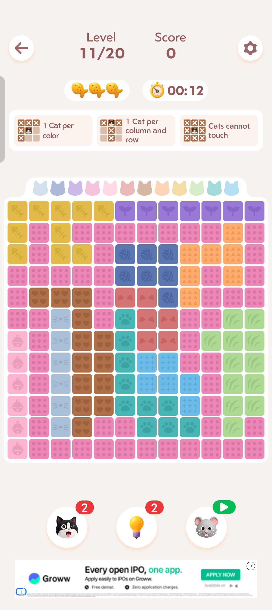
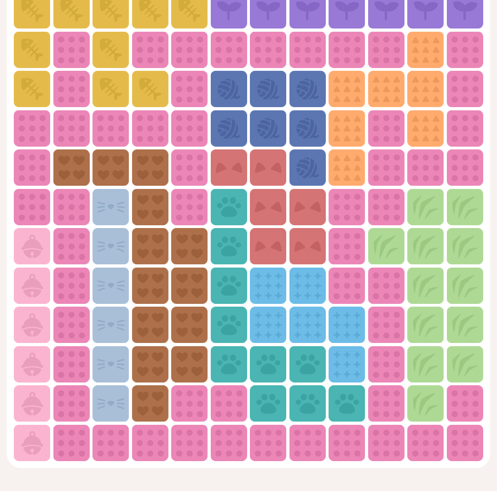
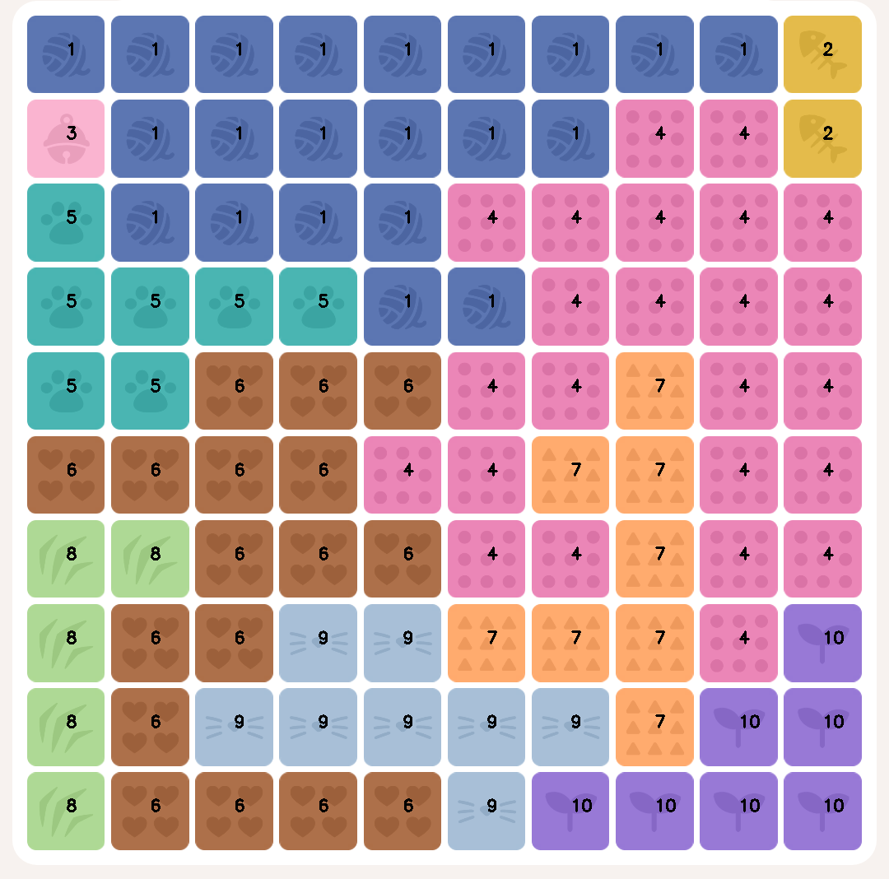
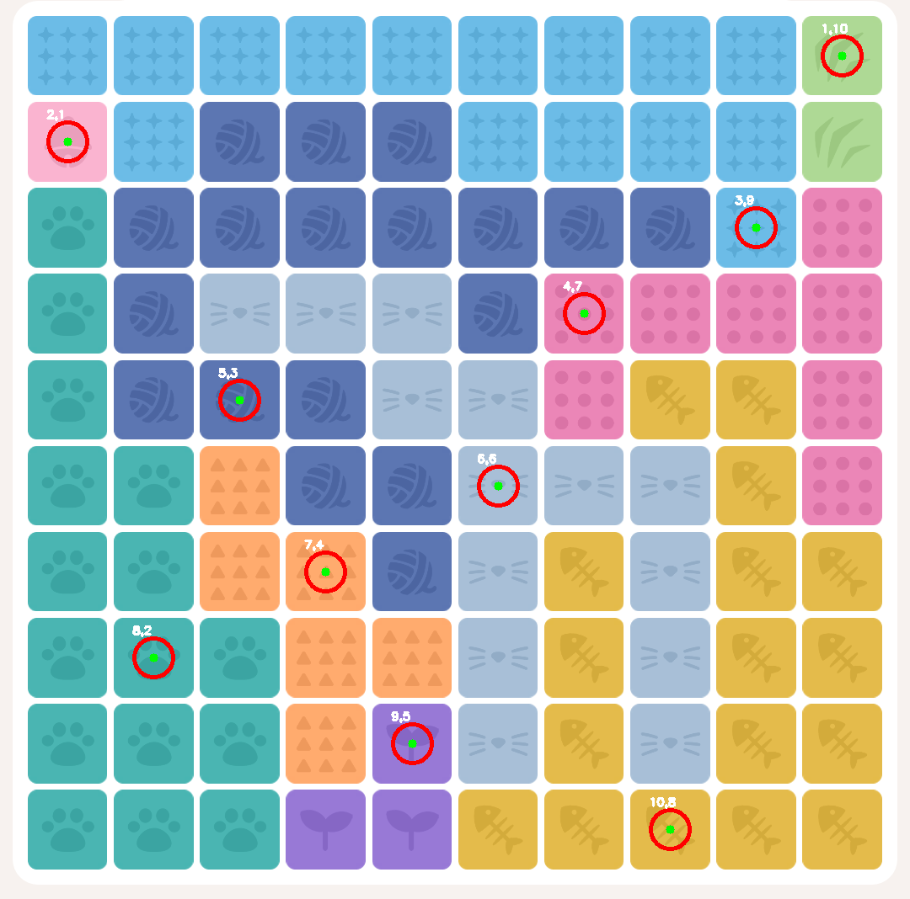

# 🐱 Meowdoku Solver

<p align="center">
  
</p>

<p align="center">
  <strong>From Android Screenshot to a Solved Puzzle — Automatically.</strong>
  <br>
  A C++ and OpenCV-powered computer vision and constraint-solving project.
</p>

<p align="center">
  <a href="https://github.com/Divyanshu-sharma-coder/Meowdoku-Solver-">
    
  </a>
  
  
  
</p>

<p align="center">
  **Computer Vision · Constraint Satisfaction · Backtracking · Android ADB**
</p>

---

## ✨ What We Built

Meowdoku Solver is an automated puzzle-solving system for the Android game **Meowdoku**.

Instead of manually analyzing the board and guessing where cats belong, the system captures the phone screen, extracts the puzzle, detects its structure and colored territories, computes valid placements, and generates a visual solution.

It combines classical computer vision with constraint satisfaction algorithms to transform a visual puzzle into a structured problem that a C++ program can solve.

## 🚀 Features

| Feature | Description |
|---|---|
| 📱 Android Screen Capture | Captures the phone screen using ADB |
| ✂️ Automatic Board Cropping | Extracts the puzzle from the full screenshot |
| 🔲 Dynamic Grid Detection | Detects rows, columns, cell boundaries, and centers |
| 🎨 Color Region Detection | Identifies connected colored territories |
| 🧠 Constraint Solver | Finds valid placements using recursive backtracking |
| ⚡ MRV Optimization | Prioritizes the most constrained choices |
| 🔍 Forward Checking | Detects impossible choices early |
| 🎯 Move Analyzer | Classifies placements as invalid, dead-end, or globally viable |
| 🖼️ Solution Visualization | Generates an annotated solution image |
| 🖱️ One-Click Workflow | Automates capture and solving through a BAT launcher |

## 🛠️ Tech Stack

<p>
  
  
  
  
  
  
  
</p>

| Technology | Purpose |
|---|---|
| C++ | Core application and solving engine |
| OpenCV | Image processing and computer vision |
| CMake | Build configuration |
| vcpkg | C++ dependency management |
| Python | Lightweight ADB screenshot capture |
| Android Debug Bridge | Communication with the Android device |
| MSVC | Windows C++ compiler |

## 🧩 Understanding the Puzzle

The solver works with four main puzzle constraints:

1. **One cat per row:** Every row must contain exactly one cat.
2. **One cat per column:** Every column must contain exactly one cat.
3. **One cat per region:** Every colored territory must contain exactly one cat.
4. **No diagonal touching:** Cats cannot occupy immediately diagonal neighboring cells.

The solver searches for an arrangement that satisfies all these conditions simultaneously.

## 🧠 How It Works

```text
             ANDROID DEVICE
                    |
                    v
             ADB SCREEN CAPTURE
                    |
                    v
            AUTOMATIC BOARD CROP
                    |
                    v
              GRID DETECTION
                    |
                    v
           COLOR REGION DETECTION
                    |
                    v
             CONSTRAINT SOLVER
                    |
                    v
             MOVE ANALYZER
                    |
                    v
           VISUAL SOLUTION OUTPUT
```

### 1. Grid Detection

The first computer vision stage identifies the puzzle's grid.

It extracts:

- Number of rows and columns.
- Individual cell boundaries.
- Center coordinates of every cell.
- Dynamic board dimensions.

The detector is designed to handle different board sizes instead of relying on one fixed grid.

### 2. Region Detection

Meowdoku contains irregular colored territories. Identifying these territories requires more than simply comparing individual pixels.

The region detector:

1. Samples multiple small patches inside each cell.
2. Uses median color sampling to reduce visual noise.
3. Converts color information into LAB color space.
4. Compares neighboring cells using color distance.
5. Uses Disjoint Set Union (DSU) to group connected cells.

The result is a two-dimensional region map in which each cell is assigned a region ID.

### 3. Constraint Solver

The core solving engine uses recursive backtracking.

It maintains the following constraints:

- Row uniqueness.
- Column uniqueness.
- Region uniqueness.
- Diagonal non-adjacency.
- Compatibility with existing cat placements.

**Optimization algorithms**

| Algorithm | Role |
|---|---|
| Backtracking | Explores possible placements and reverses invalid choices |
| MRV (Minimum Remaining Values) | Prioritizes the most constrained variable |
| Forward Checking | Detects future conflicts before searching deeper |
| Constraint Validation | Rejects placements that violate puzzle rules |

The solver also reports search statistics, including explored nodes and backtracks.

### 4. Move Analyzer

The Move Analyzer evaluates candidate cells beyond their immediate validity.

It tests whether the remaining puzzle can still be solved after placing a cat in a particular cell.

| Classification | Meaning |
|---|---|
| Invalid | Violates an immediate puzzle constraint |
| Dead-end | Locally valid, but leaves no complete solution |
| Globally viable | Leaves at least one complete valid solution |

This makes it a constraint-aware move analyzer rather than a simple rule checker.

### 5. Visual Solution Generator

After solving, the application generates an annotated image showing:

- Computed cat positions.
- Placement markers.
- Row and column references.
- Visual coordinates for easier manual placement.

---

## 📸 Project Gallery

These are the project images generated or used by the application.


<table width="100%">
  <tr>
    <td align="left" valign="top">
      <h3>Original Android Screenshot</h3>
      
    </td>
    <td align="right" valign="top">
      <h3>Automatically Cropped Puzzle</h3>
      
    </td>
  </tr>
  <tr>
    <td align="left" valign="top">
      <h3>Detected Color Regions</h3>
      
    </td>
    <td align="right" valign="top">
      <h3>Computed Solution</h3>
      
    </td>
  </tr>
</table>


## 📂 Project Structure

```text
MeowdokuSolver/
│
├── assets/
│   ├── icon.webp
│   ├── templates/
│   │   └── cat.png
│   └── screenshots/
│       ├── phone_fullscreen.png
│       ├── current_puzzle.png
│       ├── region_detected.png
│       ├── region_map.txt
│       └── solution_visualized.png
│
├── include/
│   ├── region_detector.hpp
│   ├── cat_detector.hpp
│   ├── constraint_solver.hpp
│   └── move_analyzer.hpp
│
├── src/
│   ├── vision/
│   │   ├── region_detector.cpp
│   │   └── cat_detector.cpp
│   ├── solver/
│   │   ├── constraint_solver.cpp
│   │   └── move_analyzer.cpp
│   └── main.cpp
│
├── tools/
│   └── capture.py
│
├── CMakeLists.txt
├── vcpkg.json
├── RUN_MEOWDOKU.bat
└── README.md
```

*Build and dependency folders are omitted from this overview.*

## ⚙️ Getting Started

### Requirements

- Windows 10/11
- Git
- Visual Studio Build Tools with MSVC
- CMake
- vcpkg
- OpenCV
- Python 3
- Android Debug Bridge (ADB)
- Android device with USB debugging enabled

### 1. Clone the Repository

```bash
git clone https://github.com/Divyanshu-sharma-coder/Meowdoku-Solver-.git
cd Meowdoku-Solver-
```

### 2. Configure the Project

```bash
cmake -S . -B build
```

If CMake cannot automatically locate your vcpkg installation, specify its toolchain file:

```bash
cmake -S . -B build -DCMAKE_TOOLCHAIN_FILE="C:/path/to/vcpkg/scripts/buildsystems/vcpkg.cmake"
```

Replace the example path with your actual vcpkg installation path.

### 3. Build

```bash
cmake --build build --config Release --parallel 2
```

The executable is generated at:

```text
build/Release/MeowdokuSolver.exe
```

### 4. Connect Your Android Device

Enable USB debugging on your phone and connect it to your PC.

Check the connection:

```bash
adb devices
```

Your device should appear with the status:

```text
device
```

### 5. Run the Application

Open Meowdoku on your phone and make sure a puzzle is visible.

Run the launcher:

```cmd
RUN_MEOWDOKU.bat
```

The launcher handles the capture and solver workflow.

## 🔬 Engineering Highlights

This project brings together:

- Classical computer vision.
- Robust image sampling.
- LAB color-space analysis.
- Connected-component grouping.
- Constraint satisfaction problems.
- Recursive search algorithms.
- Search-space pruning.
- Android device communication.
- Automated image-processing pipelines.

The interesting engineering challenge is converting a real-world game screen into structured data that an algorithm can understand and solve.

## 🗺️ Future Improvements

- More robust cat recognition across different board appearances.
- Automatic placement of computed solutions through ADB.
- Improved board detection across screen resolutions.
- Better handling of animations and overlays.
- Performance benchmarking across larger puzzles.

## ⚠️ Disclaimer

Meowdoku Solver is an independent educational and technical project created for computer vision and algorithm experimentation.

Meowdoku is a third-party game. This repository is not affiliated with, endorsed by, or officially associated with the game's developers.

The game icon and other third-party assets remain the property of their respective owners.

## 👨‍💻 Author

**Divyanshu Sharma**

C++ · AI/ML · Computer Vision · Problem Solving

- GitHub: [@Divyanshu-sharma-coder](https://github.com/Divyanshu-sharma-coder)

---

<p align="center">
  <strong>Built with logic. Powered by C++. Inspired by cats. 🐈</strong>
  <br><br>
  If you find this project interesting, consider giving it a ⭐
</p>